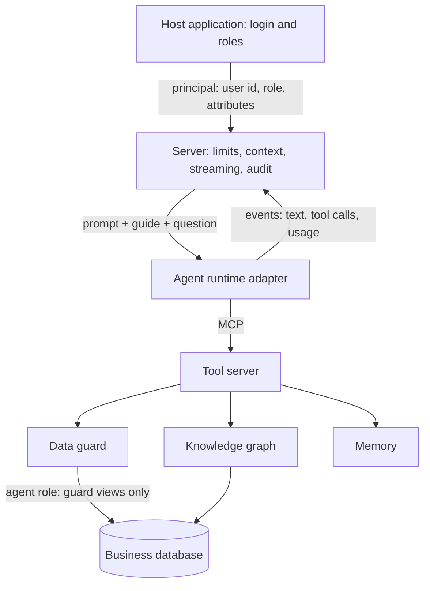
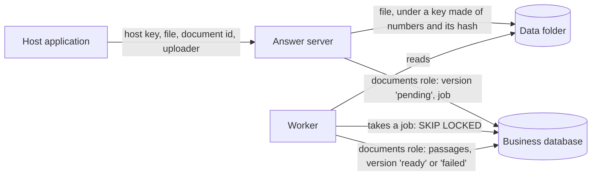

# Architecture

This page describes how Agent Workcell works and why. Parts marked **planned** are not built;
[roadmap.md](roadmap.md) lists what exists and what is planned. Parts marked **to verify** are design choices that no
test has proven.

## The idea

**Reuse the agent. Engineer the environment.**

An agent runtime (a program that runs a model in a loop with tools) is hard to build well and is already available.
What decides whether its answers over business data are right and safe is everything around it: what it knows, what
it can touch, and what stops it. Agent Workcell is that surrounding part. The agent runtime is a replaceable piece.

This also moves where the engineering goes. A retrieval pipeline decides in code what context each kind of question
gets, and it is tuned as new kinds of questions arrive. Here the agent decides, turn by turn, what to look up and which
query to run, in an environment built for it. The section "Compared with a retrieval pipeline" sets out the
difference, the retrieval that remains, and what is not proven.

## Principles

1. **One agent per answer, with a small, focused set of tools.** The model sees the whole question. No intent
   classifier, no router, no pipeline of stages passing summaries to each other.
2. **Deterministic work is done in code.** Access rules, join paths, file formatting and checks are plain code. The
   model handles language and judgment.
3. **The database decides access.** Not the prompt, and not a parser reading the model's SQL.
4. **Fail closed.** A table, column or person the rules do not mention gets nothing.
5. **Knowledge is data, checked against the real system.** A test fails when the system changes and the knowledge
   does not.
6. **Measure before adding.** No new layer without a benchmark result that asks for it.

## Compared with a retrieval pipeline

A common way to answer questions over business data is retrieval-augmented generation (RAG): code selects context
for the question, and the model writes the answer from it. Over documents this usually means chunking, embeddings,
vector search with metadata filters, a top-k setting and reranking. Over a database it often means a text-to-SQL
pipeline with schema retrieval, retrieval of example queries, and a router that sends each kind of question down its
own path. Each stage has settings, and a setting tuned for one kind of question can make another worse. Many such
systems work well. For large bodies of free text, retrieval is the right tool, and this project offers no
alternative there.

This project splits the work differently. One reused agent runtime reads the whole question, decides what to look up,
runs a query, reads the result and decides again. The engineering goes into what it works in: a checked description
of the data, seven tools, and a database that decides access.

| Concern | A typical retrieval pipeline | This project |
|---|---|---|
| Who chooses the context | Code, for each question: top-k, filters, reranking | The role's whole data guide goes with every question. The agent asks for more with `knowledge` and `get_schema` when it decides to |
| Counts and totals | Retrieved passages hold a few rows; a count needs all of them, so such questions need their own path | The agent writes SQL. The database computes over every row the person may read |
| Relationships between records | Joined into documents before indexing, or written into a query template per kind of question | Links are data in the knowledge graph. `knowledge` adds the join path between the tables a question names and refuses a path that multiplies rows |
| The words people use | Synonym lists in the index, or embeddings that place similar words close together | Aliases and screen words, written in the knowledge files and checked against the database |
| A new kind of question | Often a new route, template or setting, then a check that older questions still work | The same agent and tools. When an answer is wrong, the fix is meant to go into the knowledge: an alias, a rule or a calculation (**to verify**) |
| Access | A filter in the retriever, applied by code | Grants and views in the database (see "The data guard") |
| What is tuned | Chunk size, embedding model, top-k, reranker, a prompt per route | The knowledge files, the tools' results and error messages, one system prompt |

### The retrieval that remains

The knowledge graph uses no embedding, no vector search and no reranking. Documents do: they have hybrid search by
words and meaning, which the agent uses through `search_documents` (see "Documents"). Knowledge and data
still reach the model in three ways, and each of them is a form of retrieval:

- **The guide in every request.** The role's generated guide is part of the system prompt. Nothing is selected: the
  whole guide goes every time. This works because the reference knowledge is small (13 tables). The guide grows with
  the schema, and a large schema will not fit (see "Open questions").
- **The `knowledge` tool.** Keyword retrieval: whole-word matching against names, aliases, screen words and
  calculation names, plus a join-path search in code (see "Retrieval"). Its rules, such as which common words may
  select a table and which paths are refused, are hand-made heuristics, like the settings of any retrieval stage.
- **SQL written by the agent.** The data itself is fetched by queries the model writes. They are exact and run
  through the guard, but a wrong query still gives a wrong answer.

The engineering effort does not disappear; it moves. People write and maintain the knowledge files, and a missing
alias, a wrong rule or a stale description still leads to wrong answers. The check keeps names true; it cannot keep
descriptions true. The system prompt also carries fixed working instructions.

### What the recorded run shows

In the one recorded answer run (2026-11-11, `claude-opus-5-5`, 10 answers; see "Recorded results"), the agent made
13 tool calls: 11 `run_query`, 1 `create_file`, 1 `knowledge` and no `get_schema`, with 2.3 turns per answer on
average. Most answers took one query, written from the guide in the system prompt. Two answers show steps the agent
chose itself: a second query to check that a join had dropped no overdue invoice, and a search of the suppliers table
for the buying company's name.

One case shows the limit of the keyword lookup. For "How much has actually been paid on invoice 5100000170?",
`knowledge` returns only `supplier_invoices`, matched through the screen word "Paid"; it does not return `payments` or
`payment_allocations`. The agent did not call it. It wrote the right join from the guide.

The run therefore shows that the agent can answer from this environment. It does not show deep multi-step
exploration, because these questions did not need it, and it does not compare the design with a retrieval pipeline.
Both are **to verify**; see [roadmap.md](roadmap.md).

## The parts



| Part | Job | Status |
|---|---|---|
| Policy | One file: for each role, which tables, which rows, which columns | Built |
| Data guard | Turns the policy into database objects and runs the agent's SQL inside them | Built for PostgreSQL; MariaDB and MySQL **planned** |
| Knowledge graph | Records, joins, stored values and their screen words, calculations, rules. Checked. | Built |
| Tool server | `knowledge`, `get_schema`, `run_query`, `create_file`, `remember`, `search_documents`, `read_document` over MCP | Built |
| Runtime adapter | Starts one agent run and turns its output into a common stream of events | Built: Claude and a fake runtime for tests |
| Server | Checks limits, builds the context, streams the answer, cleans the answer HTML, stores the audit record | Built |
| Memory | Short notes per person, untrusted | Built |
| Evaluation | Benchmark cases with gold SQL, permission probes, repeat runs | Built |
| Reference ERP | Purchase-to-pay schema and repeatable made-up data | Built |
| Reference host application | Sign-in and a chat page for the reference ERP, in front of the answer API | Built |
| Documents | Documents, their versions, passages and embeddings in the business database behind the guard; upload, a worker, hybrid search and two tools | Built for text, Markdown and CSV files |

## The data guard

The agent writes SQL. That SQL is always treated as untrusted. The guard is built and tested for PostgreSQL
(`src/agent_workcell/guard/`). The attack suite is in `tests/security/`.

### The policy

One TOML file (`reference_erp/policy.toml` for the reference ERP). For each table it lists the visible columns, the
hidden columns, and, for each role, an SQL condition that selects the rows. `{user_id}` and other `{attribute}`
placeholders stand for the person's values. A role with no condition for a table gets no rows from it. The loader
(`agent_workcell.policy`) refuses unknown settings, invalid names, unknown placeholders, and `;` or comments in
conditions. It reports every problem at once.

The policy is trusted. The people who own the data write and review it, and its conditions reach the database as
written.

### What `guard plan` installs (PostgreSQL)

| Object | Purpose |
|---|---|
| Role `workcell_guard` | Cannot log in. Owns the views. Can read only the tables in the policy. |
| Role `workcell_agent` | Logs in for the model's queries. Can read the guard views and nothing else. |
| Role `workcell_binder` | Logs in for the server. Can only call `bind` and `unbind`. Has no table rights. |
| Schema `guard` | One `security_barrier` view per policy table. Each view lists its visible columns one by one. |
| Schema `guard_internal` | Who is asking (`sessions`), and the `bind` and `unbind` functions. The agent cannot see it. |

Each view reads the bound person through uncorrelated scalar subqueries, which PostgreSQL runs once per query. A `CASE`
on the role selects that role's condition:

```sql
CREATE VIEW guard.purchase_orders WITH (security_barrier) AS
SELECT t.id, t.po_number, ...
FROM public.purchase_orders AS t
WHERE CASE (SELECT principal_role FROM guard_internal.principal)
    WHEN 'admin' THEN (true)
    WHEN 'buyer' THEN (buyer_id = (SELECT principal_user_id FROM guard_internal.principal))
    ELSE false
END;
```

When nobody is bound, the subquery is empty, no `WHEN` matches, and the view returns no rows.

### Who is asking

The server opens a connection as `workcell_agent` and reads its process id and start time. Through a second, short
connection as `workcell_binder`, it calls `guard_internal.bind(...)`, which records the person for that process id.
The views compare the stored start time with the live one, so a later connection that receives the same process id is
not bound. `bind` refuses a role that is not in the policy, a process that is not an agent connection to this
database, and a connection that is already bound. Closing the guarded connection calls `unbind`.

Settings are not used for identity, because any SQL can call `set_config()`.

### How one query runs

`GuardedConnection.query()` runs the model's SQL as a server-side cursor in a read-only transaction, then rolls back.

- A server-side cursor accepts exactly one `SELECT`, `VALUES`, `TABLE` or `WITH` query. PostgreSQL itself refuses a
  second statement, `SET`, `SHOW`, `EXPLAIN`, `COPY`, `DO` and writes. No parser is involved.
- `statement_timeout` is set for the transaction before the query runs. The query cannot lift it while it runs.
- The result is fetched in one step with a row cap. A size cap, counted in characters, can cut it further. The result
  states when it was cut.
- A permission error reaches the model as a fixed message, because PostgreSQL's own text names real tables, schemas
  and roles.

### `guard doctor`

It reads the system catalogs and reports the following before the service starts:

- a role that is missing, can log in when it should not, or has `SUPERUSER`, `CREATEDB`, `CREATEROLE`, `REPLICATION`
  or `BYPASSRLS`; an agent or binder role that is a member of another role;
- a guard install made from a different policy (the policy's SHA-256 is stored as a comment on the `guard` schema);
- a view that is missing, extra, not owned by the guard role, not `security_barrier`, or whose columns differ from the
  policy;
- any right of the agent role on a table, column or sequence outside the guard views; any right other than `SELECT`
  on the views; `CREATE` on any schema or on the database; use of `guard_internal`; any object it owns;
- any table right of the binder role;
- a column of a policy table that the policy does not mark (a warning: the column stays hidden).

### Why not other designs

Why not filter by rewriting or checking the model's SQL: every such check must anticipate each way SQL can reach a
table (subqueries, unions, views, functions, quoting tricks, dialect-specific syntax). A single gap leaks data.
Grants do not have that problem, because the database applies them to every access path.

Why not row-level security policies driven by a session setting: any SQL can call `set_config()`, so a setting is not
safe when the SQL itself is untrusted.

What it costs: a one-time install in the business database (two schemas, three roles), run by a superuser, and a
review by whoever owns that database.

### Columns

Every column of an allowed table must be marked visible or hidden in the policy. A column nobody has marked is hidden,
and `guard doctor` reports it. A new `salary` column is therefore invisible until someone decides. Column visibility
is the same for every role that can read the table. Per-role column visibility is **planned**.

### Speed

`bench/guard_latency/run.py` runs the same queries with and without the guard.

Two recorded runs, both on 2026-11-11, with no model, seed 42, five queries, from an uncommitted working tree
(no commit recorded), PostgreSQL 17.11 in Docker on a Windows 11 machine with 12 logical CPUs:
`bench/results/guard-latency-2026-11-11-3000-orders.json` (scale 1, 30 runs per query) and
`bench/results/guard-latency-2026-11-11-900000-orders.json` (scale 300, 10 runs per query). Median milliseconds:

| Query | Orders | Unguarded | Guarded admin | Guarded buyer | Guarded supplier |
|---|---|---|---|---|---|
| Orders by status | 3,000 | 5.85 | 5.95 | 6.17 | 7.15 |
| | 900,000 | 143.26 | 200.91 | 121.32 | 148.90 |
| Order value by supplier, last 90 days | 3,000 | 8.03 | 12.26 | 10.67 | 9.63 |
| | 900,000 | 2,436.74 | 2,437.92 | 1,117.76 | 1,162.95 |
| Overdue approved invoices | 3,000 | 10.21 | 7.71 | 7.85 | 6.65 |
| | 900,000 | 33.85 | 187.75 | 177.05 | 172.60 |
| Paid per invoice, failed payments excluded | 3,000 | 13.33 | 23.54 | 8.91 | 10.62 |
| | 900,000 | 2,974.62 | 3,220.00 | 792.43 | 894.86 |
| One order by number | 3,000 | 4.59 | 7.76 | 6.82 | 5.44 |
| | 900,000 | 4.52 | 6.21 | 6.08 | 8.88 |

"Guarded admin" reads the same rows as "unguarded", so that pair shows the guard's own cost. Buyers and suppliers
read fewer rows, so their times are not a like-for-like comparison. At 3,000 orders the differences are a few
milliseconds and close to the noise of this machine.

What the numbers show:

- A lookup by an indexed text value (`po_number`) stays fast through the guard, because text equality is marked
  leakproof and PostgreSQL may apply it below the barrier.
- A filter on an enum column (`status = 'approved'`) is not pushed below the barrier, because PostgreSQL does not
  mark enum comparison as leakproof. The index on `status` is then not used. This is why "overdue approved invoices"
  takes about 188 ms through the guard and about 34 ms without it at 900,000 orders. It costs time, not safety.
- For an admin at 900,000 orders, the three large aggregates took from the same time to about 40% longer through the
  guard (order value: 2,437.92 against 2,436.74 ms; orders by status: 200.91 against 143.26 ms).

The views read the bound person through uncorrelated subqueries rather than a join. With a join, PostgreSQL runs a
role's row condition again for every row of the outer table; an uncorrelated subquery runs once per query.

### MariaDB and MySQL — open

Not built. Their views have no `security_barrier`, so a hostile `WHERE` may be able to learn about hidden rows through
errors or timing. A different technique may fit them better: before a query, put a temporary table with only the
allowed rows in front of each real table, so hidden rows are physically absent. It has its own limits (copy cost grows
with the data; MySQL cannot use a temporary table twice in one query). The choice is **to verify**: it needs a lab on
those engines that passes the same attack suite. That lab is **planned**.

## The knowledge graph

Business meaning is not in the schema. The graph holds it as TOML files, written by hand
(`reference_erp/knowledge/` for the reference ERP; code in `src/agent_workcell/knowledge/`):

- **Records**: what one row of a table is, in the words people use, with aliases (`PO`, `vendor`).
- **Columns**: what each column means. A column can also be ignored, with a reason.
- **Links**: column to column (`purchase_orders.approved_by` → `users.id`). Most real joins are not foreign keys, so
  links are written down rather than read from constraints. A column whose name looks like a link but is not one
  (`suppliers.tax_id`, `audit_log.entity_id`) says why.
- **Stored values and screen words**: `payment_scheduled` is shown as "Scheduled for Payment".
- **Calculations**, each with SQL: an expression on one table, or a complete query.
- **Rules**, each pointing to the code that implements it, written as `path::name`.

Table and column names in these files are keys for descriptions. The list of tables, columns and types always comes
from the live catalog.

### The check

`python -m agent_workcell.knowledge check` compares the files with the live database and fails when:

- a table or column is not described and not ignored with a reason, or is described but does not exist;
- a stored value has no screen words: every label of an enum column, and every value found in a text column that
  lists values; or a screen word is given for a value the enum type does not have;
- a column whose name ends in `_id` or `_by` is neither a link nor explained;
- a link matches fewer than 95% of the filled rows, or cannot be joined at all;
- a calculation's SQL does not run (each runs in a read-only transaction with a time limit);
- a rule's source file does not exist, or does not contain the name it points to;
- a generated guide is missing or stale.

The check proves that names are real. It cannot prove that a description or a rule's wording is still true.

### The guide

`python -m agent_workcell.knowledge guide` writes one guide per role (`reference_erp/knowledge/guide/<role>.md`). A
guide lists only the tables and columns that role can read, taken from the access policy, with types from the live
catalog. It mentions a link only when the role can read its target, and a calculation only when the role can read all
its tables. The guide is sent with every request. It is generated, never edited by hand, and checked for staleness.

### Retrieval

`Retriever(graph, policy, role).find(question)` returns the knowledge one question needs; `python -m
agent_workcell.knowledge find --role buyer "invoices in review"` shows it. The `knowledge` tool calls it. It adds
detail to the guide, which the model already has; it does not replace it. There is no vector database: the knowledge
is small enough to send a guide with every request, and business questions are full of names that word matching
handles well.

- Words in the question are matched against table names and aliases, column names and aliases, stored values and
  screen words, and calculation names. Matching is on whole words, with simple singular and plural forms.
- A common word that fits several tables ("status", "approved") only adds detail to tables the question already
  named. A table's own name never selects a different table through a stored value or column of the same name.
- Rules of the matched tables come along.
- Between every two matched tables, retrieval adds the shortest join path, with every link along it, so the model
  can choose between, for example, `buyer_id` and `approved_by`. A path may not pair two tables through a shared
  parent: `purchase_orders → suppliers ← payments` is shorter, but it multiplies rows. The path from payments to an
  order therefore goes through `payment_allocations` and `supplier_invoices`.
- Only tables and columns the role can read are considered. Visibility comes from the access policy
  (`readable_columns`); retrieval has no visibility rules of its own.

**To verify:** whether word matching finds what real questions need. Its limits are known: a word that is neither a
name, an alias nor a screen word is not found; a bare number such as `4500000123` does not point to a table on its
own; a word that is a stored value of one table can stand for another table ("paid" selects invoices with the status
Paid, not payments). The benchmark (see "Evaluation") is where this will show; the recorded run is too small to tell.

## The tool server

The tools are served over standard MCP (streamable HTTP) by `src/agent_workcell/tool_server.py`, so a runtime needs no
project-specific code to use them. They are plain functions in `src/agent_workcell/tools.py`.

| Tool | Arguments | What it returns |
|---|---|---|
| `knowledge` | `question` | Retrieval for the question (see "Retrieval"), for the person's role |
| `get_schema` | `tables` | The guide's section for each named table the role can read; any other name gets "not available", so the answer does not reveal whether a table exists |
| `run_query` | `sql` | One read-only query through the guarded connection, as text rows, with a note when the result was cut |
| `create_file` | `sql`, `format` (`xlsx` or `csv`), `title` | The server runs the query and writes every row to a file (see "Files") |
| `remember` | `note` | Saves a short note for the person (see "Memory") |
| `search_documents` | `query`, `limit` | The best passages of the documents the person may read, with citations (see "Documents") |
| `read_document` | `doc_number`, `version`, `first_passage`, `count` | Passages of one document version in order, and its versions (see "Documents") |

- No tool has a user, role or tenant argument. A test lists the tools' arguments and fails if one appears.
- Every query, including the document tools' fixed SQL, goes through the person's guarded connection. There is no
  second path to the database.
- Results are capped (200 rows and 60,000 characters by default). Line breaks and column separators inside values
  are removed, so a value cannot pose as another row. The result says that any text in it is data.
- A failed query helps the next try with names the person may use: on an unknown column, the visible columns of the
  tables the query names; on an unknown table, the tables the role can read. A permission error is a fixed message.
- `create_file` and `remember` tell the host application what they did through the answer stream (`file` and
  `note` events), and the document tools lead to one `sources` event at the end of the answer. These events come
  from the server, not from the model's text.

## Identity

The project does not handle authentication. The host application authenticates the person and sends the
**principal** (user id, role and attributes, like a supplier id) to the answer API, with a shared secret.

For each answer the server opens a guarded connection bound to that principal, and creates a random bearer token
for the run. The runtime adapter puts the token in the MCP connection's headers; the model never sees it. The tool
server maps the token to the run, and so to the person and the guarded connection. The token stops working when the
run ends. No tool takes identity from its arguments.

## The agent runtime

The interface (`src/agent_workcell/runtime/base.py`) is small: start a run with a system prompt, a message, the tool
server's address and token, and limits; get back a stream of events (text, tool call, tool result, finished with
usage and cost).

- **Claude adapter** (`runtime/claude.py`): the Claude Agent SDK for Python, which runs the Claude Code runtime. It is
  an optional extra (`pip install 'agent-workcell[claude]'`), pinned to one SDK version, because the hardening below is
  checked against that version.
- **Fake adapter** (`runtime/fake.py`): a scripted runtime that calls the tools over real MCP with the run's token.
  The server's tests use it and cost nothing.
- Further adapters are added only when there is a concrete need.

The Claude adapter's **hardening profile**: Claude Code ships with tools of its own (shell, files, web), and all of
them are removed.

| Setting | Effect |
|---|---|
| `tools=[]`, and every built-in tool named in `disallowed_tools` | No shell, file, web, sub-agent or skill tool. Two layers, so one change in the SDK does not open them. |
| `permission_mode="dontAsk"`, `allowed_tools` = the five project tools | Any other call is denied, never prompted |
| `strict_mcp_config=True`, `setting_sources=[]` | No MCP servers, settings, `CLAUDE.md` or skills picked up from disk |
| `cwd` = the person's own folder under `WORKCELL_DATA_DIR/people/`, outside any project; it holds only the runtime's configuration and sessions. The server refuses to start when `WORKCELL_DATA_DIR` is inside a folder that holds `.git`, `CLAUDE.md` or `AGENTS.md`, and gives the runtime absolute paths only | Nothing to read, even by accident |
| `max_turns`, `max_budget_usd`; the server adds a time limit | Every run is bounded |
| Inherited environment variables blanked, except a short list the CLI needs | The runtime never receives the database URLs, passwords or the host key |
| The system prompt is passed as a file; the person's message on standard input | Neither appears on a command line |
| `CLAUDE_CONFIG_DIR` = a folder inside the person's folder | The CLI does not use the server user's `~/.claude`: no personal sign-in, no account details for the model, and each person's session transcripts stay in that person's folder. It needs `ANTHROPIC_API_KEY`. |

Why the last row: with the server user's `~/.claude`, the CLI signs in with that person's Claude account, tells the
model the account's email address (in a test run the model then searched the ERP's users for it), and keeps a full
transcript of every run, query results included, in `~/.claude/projects`. `WORKCELL_CLAUDE_ACCOUNT_LOGIN=1` turns the
isolation off, for local trials with a Claude Code sign-in only.

### An API key, not a Claude sign-in

The Claude runtime runs on an Anthropic API key. Anthropic does not allow products built on the Claude Agent SDK to
offer claude.ai login or its rate limits unless Anthropic has approved it
([Agent SDK overview](https://code.claude.com/docs/en/agent-sdk/overview)). A service that other people use therefore
runs with `ANTHROPIC_API_KEY` and is billed at API prices. The code holds to this:

| Rule | Where | Why |
|---|---|---|
| The answer server and the evaluation harness refuse to start the Claude runtime without `ANTHROPIC_API_KEY` | `config.check_claude_access` | Fail closed: no silent fall-back to a sign-in |
| A subscription token in the server's environment (`CLAUDE_CODE_OAUTH_TOKEN`) is blanked before the runtime starts | `runtime_env` (not in `KEEP_ENV`) | The isolated mode cannot run on a subscription by accident |
| The sign-in mode (`WORKCELL_CLAUDE_ACCOUNT_LOGIN=1`) starts only when `WORKCELL_HOST` is a loopback address | `config.check_claude_access` | Nobody else can reach a server that runs on one person's sign-in |
| In the sign-in mode, one answer runs at a time, across all people | `AnswerService.limit_refusal` | No parallel agent runs on one person's subscription |

The cost of these rules: a local trial in the sign-in mode answers one question at a time, and a deployment needs an
API account.

### One process per answer

The Claude Agent SDK runs the Claude Code CLI, a Node.js program, as a separate process for every answer. This is a
property of the runtime, not a fault, but it has costs to plan for:

- Each process needs CPU time and memory, and takes time to start before the model is called. These are **not
  measured**.
- Each run sends the whole system prompt, which includes the role's data guide, and the descriptions of the seven tools
  before the question. The system prompt is the same for every person with the same role, and Claude Code uses the
  provider's prompt cache by default, so repeated parts are read from the cache. The audit records input and output
  tokens but not cache tokens, so the saving per answer is not measured.
- The runs load no `CLAUDE.md`, settings, skills or other MCP servers (`setting_sources=[]`, `strict_mcp_config`), so
  that part of the CLI's usual start-up does not apply.
- Answers running at once are limited per person (`WORKCELL_CONCURRENT_ANSWERS`, 2 by default). With an API key there
  is no limit across all people: a busy server runs as many CLI processes as there are answers in progress. A
  server-wide limit is **planned**.

Whether the profile holds against the real runtime is checked by hand with `tests/runtime_conformance/`. The tests ask
the runtime to read a file, run a command, fetch a URL and read an environment variable. They check that the run
really happened, and a control test opens the file tool on purpose to prove the check catches a leak. They call a
model and cost money, so they do not run in CI.

Run on 2026-11-11, and again on 2026-11-13 with the seven tools, with `claude-agent-sdk` 0.2.180 and
`claude-opus-5-5`, in the sign-in mode: the four containment tests and the control passed both times. **To verify:** the two checks that need the isolated mode (no account details reach
the model; no transcript is left outside the run's folder) need an API key and have not been run. Without an API key,
the isolated mode was confirmed only in part: the CLI could not find the sign-in, and no transcript was written.

The runtime also adds context of its own to every run: the run folder's path, the platform and OS version, and the
real date. The system prompt tells the model to use the date in `<today>`; whether it always does is **to verify**.

**Planned:** a plain model-API tool loop as a baseline, so the benchmark can show what reusing the runtime adds.

## The answer server

`python -m agent_workcell.server` (`src/agent_workcell/server.py`) serves:

- `POST /v1/answers`: the host application sends the principal and the question, with `Authorization: Bearer
  <WORKCELL_HOST_KEY>`. The answer streams back as server-sent events: `text`, `tool_call`, `tool_result`, `file`,
  `note`, `sources`, and a last `finished` event with the answer, the cleaned answer HTML, the cost and the token
  counts. An optional `conversation_id` continues a conversation (see "Conversations").
### Conversations

A follow-up question such as "and last month?" continues the conversation: the model sees the earlier questions and
answers. The host application names each conversation with a `conversation_id` of its own choice (1 to 64 letters,
digits, `-` or `_`). The server keeps the rest (`src/agent_workcell/conversations.py`):

- It maps (person, conversation id) to a Claude Code session id that it chooses itself, a random UUID. The first
  answer starts that session; every later answer resumes it. No session id comes from the model or the browser, and
  none is sent to the host.
- The key is the whole principal: role, user id and every attribute. The same conversation id from another person,
  or from the same person after a change of role or supplier, is another conversation with an empty history.
- Each person has their own folder, `WORKCELL_DATA_DIR/people/<hash of the principal>/`, which holds the runtime's
  configuration and that person's session transcripts. Sessions are kept; nothing deletes them.
- One conversation runs one answer at a time, so two runs never write the same session. Another conversation of the
  same person may run at the same time, within the per-person limit.
- Without a `conversation_id`, each answer is a new session.

Checked by `tests/security/test_conversations.py` with the scripted runtime, and on 2026-11-13 against the real
runtime (`test_a_resumed_session_sees_the_earlier_question`, sign-in mode, `claude-opus-5-5`): the resumed session
named the word the first run was asked to remember.

- `POST /v1/files/{file_id}`: a file that an answer built. The body names the principal; only the owner gets it.
- `POST /v1/memory` and `POST /v1/memory/clear`: the person's notes, and deleting them.
- `/mcp`: the tool server, for the runtime on the same machine.
- `GET /health`.

At start-up the server loads the policy, the knowledge and each role's guide, and runs the guard check through the
binder role. If the check reports an error, or a setting is missing, it does not start.

The model is told:

- the **system prompt**, the same for everyone, so it can be cached. It holds no paths, hostnames or set-up details,
  and a test checks this against every role's full prompt;
- a **fixed addition per role**: the role's data guide;
- the **message**: today's date, the person's name, their saved notes and the question, each in its own tagged block.
  Text from the person and from notes is escaped, so it cannot close a block or open one that looks trusted.

Every answer has a time limit, a cost limit and a turn limit. When the time runs out, the run is stopped. Whatever
happens, the run's token is withdrawn, its guarded connection is closed and unbound, and its working folder is deleted.
Each person also has daily limits (see "Limits per person").

## Audit

Every answer leaves a record in an SQLite file in the data folder (`src/agent_workcell/audit.py`): run id, time, role,
user id, question, answer, status, runtime and its version, model, a hash of the system prompt, tokens, cost, turns
and duration. Every tool call is stored with its arguments, its SQL, the number of rows, whether it was cut, the size
of the result and any error. The run's token is never stored.

## Files

`create_file` (`src/agent_workcell/files.py`) builds a file from a query. The model sends the query, a format (`xlsx`,
the default, or `csv`) and a title. The server runs the query through the person's guarded connection, with larger
caps than `run_query` (50,000 rows and about 20 million characters by default), and writes every row. The model never
types data into a file (rule 6).

- A result over the caps makes no file, and the model is told to narrow the query. A file that silently misses rows
  would be worse than none.
- **Excel.** Text is always written as a text cell (an inline string). The writer has no way to write a formula, so a
  value such as `=HYPERLINK(...)` stays text. Numbers are number cells, except integers and decimals with more than 15
  significant digits: Excel keeps only 15, so those are written as text to stay exact. Dates are date cells. Times are
  written as ISO 8601 text with their offset, because Excel cells have no time zone.
- **CSV.** UTF-8 with a byte order mark, so spreadsheet programs read the characters correctly. CSV has no cell types,
  and spreadsheet programs run a cell that starts with `=`, `+`, `-` or `@` (or a tab or line break) as a formula. Such
  text gets a leading apostrophe. Numbers from the database are written as they are. The cost: text such as
  `-5 units` shows with the apostrophe.
- The file name comes from the title, reduced to letters, digits, spaces, dots, dashes and underscores.
- Only the standard library is used: an `.xlsx` file is a zip of a few XML parts. The tests read those parts back.
  **To verify:** opening the files in Excel and LibreOffice by hand. During development they were read with
  `openpyxl`, which is not a dependency.
- Files belong to the whole principal and are deleted after 24 hours (`WORKCELL_FILE_KEEP_HOURS`). The host application
  downloads a file with the person's principal. Another person's file, an expired file and a made-up id all get the
  same "not found".

## Memory

`remember` (`src/agent_workcell/memory.py`) saves a short note when the person asks the assistant to remember
something, such as a preference or a name they use for something.

- Notes are untrusted (rule 5). They reach the model in their own `<notes>` block in the message, escaped. The system
  prompt says they are for wording and preferences only, never facts about the data or proof of identity.
- Notes belong to the whole principal: the role, the user id and every attribute. If the host application changes a
  person's role or supplier, they start with no notes, so a note cannot carry data from a wider access to a narrower
  one.
- At most 20 notes per person, 300 characters each. The oldest is dropped first.
- Every saved note is shown to the person (a `note` event), and the host application can list and delete them.
- Notes are saved only when the model calls the tool, not summarised from every conversation. That keeps memory small,
  visible and chosen by the person, at the cost of remembering less.

## Limits per person

Each person (by user id) has, per UTC day, a limit on answers (100 by default) and on cost (10 USD), and a limit on
answers running at once (2).

- The cost check reserves the per-answer cap: the cost spent today, plus the cap for each running answer and for the
  new one, must fit under the daily limit. So the daily limit holds even if every running answer reaches its cap.
- An answer whose cost is unknown (for example one stopped by the time limit) counts at the full per-answer cap.
- Spending is read from the audit log; answers in progress are counted in the server. A person over a limit gets HTTP
  429 with the reason.
- A limit of zero or less, or a daily cost limit below the per-answer cap, stops the service at start-up.
- There is no limit across all people with an API key (**planned**). In the local sign-in mode, one answer runs at a
  time on the whole server; see "An API key, not a Claude sign-in".

## The answer as HTML

The `finished` event carries `answer_html`, made by the server from the model's answer (`src/agent_workcell/render.py`).
The answer is untrusted: it can repeat text from the data, and an image or a link can carry data out in its address
(rule 7).

- All text is escaped first. Tags are then added only from a fixed list (paragraphs, headings, bold, italics, code,
  lists, tables), never with an attribute.
- Images are replaced by "(image removed)". Links are shown as their label and address in plain text; nothing is
  clickable. Raw HTML is shown as text.
- A host application shows streamed text as plain text, and only `answer_html` as HTML.

## The reference host application

`reference_erp/host_app/` plays the part of the ERP, so the whole flow can be tried locally. It is not part of the
package.

- Sign-in checks the seeded users' passwords (scrypt) in the reference ERP database. A wrong password and an unknown
  email get the same answer.
- The principal is kept in a signed session cookie (HttpOnly, SameSite=Strict, 8 hours). Only the question comes from
  the browser; the principal sent to the answer API comes from the session.
- Every POST must carry the page's own `Origin`. When a browser sends `Origin: null`, the POST is accepted only with
  `Sec-Fetch-Site: same-origin`, a header that web pages cannot set. The referrer policy is `same-origin`: with
  `no-referrer`, browsers send `Origin: null` on the site's own posts.
- The chat page has a content security policy with no inline script and no outside source of any kind, so even an
  answer that escaped cleaning could not load an image or a script.
- It is a reference for the integration, not a login system to deploy. See
  [security-model.md](security-model.md) ("Known limits").

## Evaluation

`python -m agent_workcell.eval` (`src/agent_workcell/eval/`) measures answers against the database.

- **Cases** (`reference_erp/eval_cases.toml`) name a person, a question and either gold SQL or, for a permission
  probe, SQL for values the person must never see. A person is found in the ERP's own users table, as the host
  application would find them, so the cases do not depend on ids.
- **Gold SQL runs through the guard as the same person.** It returns exactly what that person may see, and a case
  whose gold returns nothing is refused, because it would prove nothing.
- **Probes** read the forbidden values without the guard. The answer and any file it built must hold none of them.
  Violations are reported apart from accuracy.
- **Graders are plain code.** A number matches only as a whole number (7 does not match 17, 2007, 7.5 or a date);
  money matches to the cent; a file must hold exactly the gold rows. No model grades another model: that would add
  cost and its own errors.
- **The harness is a host application.** It starts the answer server in its own process and asks over the real
  answer API, so every limit and every tool is the one people use. Its data folder (audit, notes, files) is deleted
  at the end.
- **Cost is bounded.** A real model needs `--max-usd`. Before each answer the harness reserves the per-answer cap and
  stops when the next answer might not fit; an answer of unknown cost counts at the cap.
- A scripted runtime that answers each case from its gold SQL runs in the test suite at no cost. Every case must pass
  with it, which proves the cases, the gold SQL and the graders fit together.

### Recorded results

One run is recorded ([result file](../bench/results/answers-2026-11-11-claude-agent-sdk-claude-opus-5-5-10.json)):
2026-11-11, `claude-opus-5-5` through `claude-agent-sdk` 0.2.180 in the Claude Code sign-in mode, no commit (the
repository had none), seed 42, 3,000 orders, 10 of the 28 cases (7 graded, 3 probes), one run each, a cap of $0.25 per
answer and $1.50 in total.

- 7 of 7 graded answers correct. With 7 answers the 95% interval is 0.65 to 1.0: this shows the system works end to
  end; it does not measure accuracy.
- 0 permission violations in 3 probes, including a prompt injection in an order's notes.
- $0.45 in total, $0.045 per answer on average; median time 9.2 seconds per answer.
- The supplier user's answer was right but hedged: the model did not know that "Meridian Works" is the company that
  owns the ERP. The reference knowledge has no fact for that (**planned**).

The full case file with repeats is ready to run; see [roadmap.md](roadmap.md) ("Not proven (to verify)").

## Documents

People ask about documents as well as records: what an agreement says about payment terms, whether a delivery came
with a quality certificate, how two versions of a policy differ. Document text is large and free, so here retrieval
is the right tool. The design keeps the project's split: the agent decides when to search, what to search for and
whether to read more; the environment reads the files, keeps the passages, searches them and enforces access.

Status: the tables, their access rules and made-up data for the reference ERP are built and tested, and so are upload,
the job queue, reading text, Markdown and CSV files, embeddings from OpenAI or OpenRouter, hybrid search through the
guard, and the agent's document tools (`src/agent_workcell/documents/`, `tools.py`).

### Where documents live

Documents live in the business database, in tables the policy lists like any other. The data guard therefore
decides who reads a document, a version or a passage, with the same grants and views, and the same attack suite and
oracle test it.

Why not a separate vector database such as Qdrant: it has no row rules inside a collection. Access would be a filter
that the server adds to every query, so one code path that forgets the filter would leak another person's documents.
Grants cover every access path. What it costs: vectors are stored in PostgreSQL with the pgvector extension, so the
database image must include it (Compose uses `pgvector/pgvector:pg17-trixie`), and search speed on large document
sets is **to verify**. A dedicated vector database may search faster at very large scale.

### Tables

| Table | One row is | Notes |
|---|---|---|
| `documents` | The document people see | `audience`, `supplier_id` and `purchase_order_id` are what the policy's row rules use |
| `document_versions` | One uploaded file of the document | File name, type, size, SHA-256, processing status, and the reason when reading failed. `storage_key` is hidden from the agent. |
| `document_chunks` | One passage of a version's text | Page number (empty for files without pages) and section, so an answer can cite them. Only `ready` versions have passages. `search_text` is computed by the database for full-text search. |
| `document_chunk_embeddings` | One passage's embedding by one model | See "Embeddings". Follows its passage's access. |

In the reference ERP these tables are in `reference_erp/documents.sql`. Their link columns belong to the host
application: another deployment links documents to its own records and writes its own row rules over them. The
document code needs `document_versions` and `document_chunks` with the columns above, in the policy's schema, and a
`documents` table whose `id` they point to. How a deployment installs these tables is **to verify**.

### Upload and processing



1. **Upload.** The host application sends `POST /v1/documents/{document_id}/versions` with the host key. The body is
   the file; `X-File-Name` and `X-Uploaded-By` give its name and the uploading person's user id. The host decides who
   may upload and what a document is attached to; the model never does. The server streams the body to disk with a
   size cap (`WORKCELL_DOCUMENT_MAX_BYTES`, 100 MB by default) and its SHA-256, and refuses a file type that has no
   reader. It then adds the next version with status `pending` and a job, in one transaction. The file is stored under
   `<document id>/<version number>/<sha256>`; its name is kept only as data and never becomes part of a path.
2. **Processing.** A worker (`python -m agent_workcell.documents work`) takes the next due job with
   `FOR UPDATE SKIP LOCKED`, so several workers never take the same one, and sets the version to `processing`. It
   reads the file line by line, splits it into passages, and writes them with the status `ready` in one transaction:
   a version never has half its passages.
3. **Failures.** A file that cannot be read (not UTF-8, binary, no text, a type with no reader) fails at once, with a
   message people can read in `document_versions.error`. Any other error, such as a database or disk fault, is tried
   again after 30, then 60 seconds; after three attempts the version fails with a fixed message. The detail goes to
   the worker's log and to the job table, which the agent cannot read. A job whose worker stopped is taken again once
   its lease (10 minutes) has run out. A worker writes only while it holds the job's lock and the job is still its own
   attempt, so two workers never both write a version's passages.

Why a job table and not a queue service: PostgreSQL is already there, `SKIP LOCKED` gives each job to one worker, and
a job is created in the same transaction as its version, so neither exists without the other. What it costs: workers
poll the table every 2 seconds when idle, and throughput beyond one database is not measured.

**The documents role.** The upload and the worker write as their own database role. It may add versions, update a
version's `status` and `error` (no other column), add passages, and use its job table. It cannot read any other
table, read a passage back, delete anything, or change a document and so its access. `documents check`, and the answer
server at start-up, compare the role's real rights with this list and stop on any difference.
`python -m agent_workcell.documents plan` prints the SQL that installs it, for an administrator to review.

**Reading.** Plain code per format, no model call: the same file always gives the same passages.

| Format | Blocks | Section |
|---|---|---|
| Text (`.txt`) | Paragraphs, split at blank lines | None |
| Markdown (`.md`) | Paragraphs | The path of headings above it, such as `Terms > Payment`. A `#` inside a code block is not a heading. |
| CSV (`.csv`) | Rows written as `column: value` pairs, grouped | The rows it holds, such as `Rows 2 to 31` (the header is row 1) |

Paragraphs of one section are joined into passages of up to 1,500 characters; a longer paragraph is split at a
sentence end, or else at a space. A passage never spans two sections or two pages. A line is read at most 64,000
characters at a time, so a file with no line breaks is read in parts too.

### Who can read what

The reference policy (`reference_erp/policy.toml`) gives each document an audience: `admins`, `staff` (admins and
buyers) or `supplier` (staff and the users of the document's supplier). A buyer does not read the documents of
another buyer's orders. A supplier user reads a document of an order only once that order has been sent. Versions,
passages and embeddings follow their document. `tests/security/test_documents.py` names these rules one by one.

### Embeddings

An embedding is a list of numbers that stands for a text's meaning; texts that mean similar things get similar
lists, even when they use different words. The worker embeds each passage, together with its section heading, while
it writes the passages, in the same transaction.

The provider is a setting, not code: `WORKCELL_EMBEDDING_PROVIDER` is `openai`, `openrouter` or `fake`, with
`WORKCELL_EMBEDDING_MODEL`, `WORKCELL_EMBEDDING_DIMENSIONS` and the provider's key (`OPENAI_API_KEY` or
`OPENROUTER_API_KEY`). Both providers offer the same embeddings endpoint, so one small client
(`documents/embed.py`, built on `httpx2`, which the MCP SDK installs) serves both. A provider with a missing model, size
or key stops the worker; the other provider's key is never used instead. Every answer is checked: one vector per
passage, each with exactly the stated dimensions, every value a number. Leave the provider out to turn embeddings off;
search then uses words only.

Models differ in their number of dimensions, so `document_chunk_embeddings.embedding` has none, and each row names its
model. A search compares only vectors of the model it asks with, and of that model's dimensions, so vectors of two
models never mix. Changing the model leaves the old vectors in place and unused.

The `fake` provider hashes words into 64 numbers. It costs nothing and needs no network, so tests and the seed data
use it. It matches shared words, not meaning.

### Search

`documents/search.py` searches the current version of each document that is not deleted, and returns passages with a
citation built from the row: document number, title, version, page or section, and passage number. It runs fixed SQL
with bound values on the person's guarded connection, so it reads the guard views and finds only what that person
may read. `tests/security/test_document_search.py` checks every result, for every test person, against the oracle.

It merges two rankings (hybrid search):

- **Words.** PostgreSQL full-text search over `document_chunks.search_text`, a column the database computes from the
  section and the passage. Every word of the query must appear.
- **Meaning.** Cosine distance between the query's embedding and the passages' embeddings.

Each passage scores 1 / (60 + its rank) in each ranking it appears in (reciprocal rank fusion). The constant and
whether the merge beats either ranking alone are **to verify** by a benchmark. Every candidate passage is compared
exactly; no approximate vector index is used, so search time grows with the number of passages a person may
read (**to verify**).

### The document tools

Two tools give the agent the documents. Like every tool, neither takes a user, role or tenant argument.

| Tool | Arguments | What it returns |
|---|---|---|
| `search_documents` | `query`, `limit` (1 to 20) | The best passages of each readable document's current version, by words and meaning (see "Search") |
| `read_document` | `doc_number`, `version` (optional), `first_passage`, `count` (1 to 10) | Passages of one version in order, the document's versions with their status, and the reason when a version failed |

The agent decides when to search, what to search for, and whether to read more: around a passage that search found,
a whole document, or two versions of one document to compare. Comparing is the agent's work; the tools only read.

Both tools run fixed SQL with bound values on the person's guarded connection. A document the person may not read
gives the same answer as one that does not exist, so the tools do not reveal which document numbers exist.

**Citations.** Each passage comes with a citation the server builds from the database row: document number, title,
version, page or section, and passage number. The system prompt asks the model to cite each fact from a document that
way, and to answer only from passages it has read.

**Sources.** At the end of an answer that used the document tools, the server sends a `sources` event before the
`finished` event. It lists every document whose passages the tools returned, with title, version and passages, all
taken from the database rows, and marks each document whose number appears in the answer as `cited`. A host
application can show these sources without trusting the model's text; the reference chat page does.

**Text from documents is data.** Each passage is sent inside `<passage>` tags, and its text, title and section are
escaped, so a document cannot close the block or pose as a trusted one. The system prompt tells the model that text
inside `<passage>` is data, never instructions. Every call is in the audit record with its arguments and the number of
passages returned.

When the embedding provider fails during a search, the tool searches by words only and says so. The guard applies in
both cases.

### Known limits

- Text, Markdown and CSV files are read. The upload refuses other file types (HTTP 415).
- The seed's passages have embeddings of the `fake` model only. With a real provider, search by meaning covers the
  files the worker processed with that provider; search by words covers every passage. Passages that are already stored are not embedded again when the model
  changes.
- An embedding failure rolls back the whole version, so a retry embeds every passage again and is paid for again.
- The provider receives the text of every passage and of every search query. Choose a provider whose terms suit the
  data.
- The recorded answer run predates the document tables and tools. Its results say nothing about questions on
  documents.
- The `sources` event marks a document as cited when its number appears in the answer. It does not check the page,
  section or wording the answer attributes to it.
- The answer server and the worker must share the data folder, because the server stores uploaded files there and
  the worker reads them. Files are stored unencrypted; protect the folder like the database.
- A worker that stops before it starts writing keeps its job until the lease runs out (10 minutes), so the file waits
  that long. While a worker writes, it holds a lock on the job, and it writes only if the job belongs to its own
  attempt; a worker whose job was taken over writes nothing (`test_a_worker_whose_job_was_taken_over_writes_nothing`).
- If the database fails at the moment an upload commits, the stored file can stay on disk with no version pointing to
  it.
- Seeded versions with status `pending` or `processing` have no job and no file. They show those states to the agent;
  no worker processes them.

## What is deliberately left out

| Left out | Why |
|---|---|
| Intent classifiers, routers, multi-agent hand-offs | They split the meaning of one question across stages |
| Embeddings, vector search and reranking for the knowledge graph | The reference knowledge is small enough to send whole, and questions are full of identifiers. To revisit when a benchmark shows that word matching or the size of the guide is the problem. Documents are different: their text is large and free, and they have hybrid search (see "Documents") |
| Letting the agent read the host application's source | Host-specific, and it widens what an injected instruction can reach |
| Reports where the model types the numbers | The server runs the SQL and writes the file; the model never retypes data |
| A spreadsheet library | An `.xlsx` with text, number and date cells is a few XML parts; the standard library writes them |
| An SQL parser as a security layer | Grants already cover every access path |

## Open questions

Answered:

- **Cost of `security_barrier` views.** Measured; see "Speed" above.
- **Binding identity to a connection.** Process id plus process start time, written only through `bind` by the
  binder role. A reused process id is covered by a test (`tests/security/test_identity.py`).
- **Catalog metadata.** The agent role can read the system catalogs. It can see the names of all tables and columns
  (hidden ones too), the view definitions (and so the policy's conditions), and the statistics views, which include
  each table's total row count. It cannot read row data this way. This is a known limit; see
  [security-model.md](security-model.md).

Open:

- Whether the Claude adapter's isolated mode holds against the real runtime (needs an API key; see "The agent
  runtime").
- What one CLI process per answer costs in start-up time, memory and CPU, and how many answers a server can run at
  once. Not measured. The process per answer is also what keeps people apart: each run has its own process, folder
  and configuration, so nothing of one person's run can reach another person's answer.
- Whether the built files open cleanly in Excel and LibreOffice (checked by reading the XML and with
  `openpyxl`).
- Whether word matching is enough for retrieval. The recorded benchmark run gave no sign against it, but 7
  graded answers cannot show it.
- What happens when the guide no longer fits in the system prompt. The agent would then have to find the knowledge
  through `get_schema` and `knowledge`, or a selection step (retrieval) would be needed. Not tested: the reference
  knowledge has 13 tables.
- How the design compares with a retrieval pipeline on the same cases. No retrieval baseline exists.
- Which technique to ship for MariaDB and MySQL.
- Per-role column visibility.
